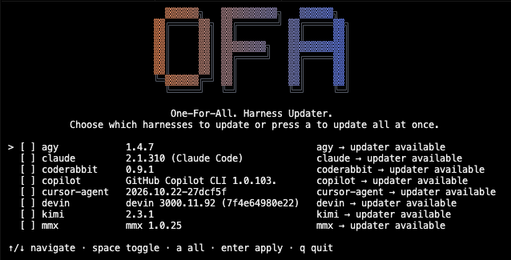

# OFA — One For All

A single command to detect, version-check, and update every coding harness on your machine.

<p align="center">
  
</p>

`ofa` knows about Claude Code, Codex, opencode, Kimi, Cursor's agent, GitHub Copilot, Antigravity (`agy`), Devin, CodeRabbit, and the rest of the popular CLI harnesses. It scans what's installed, asks each package manager / self-updater whether anything's available, and runs the update — interactive picker or one-shot.

```
$ ofa check
scan: 13 harnesses, 0 with updates, 8 updaters available
  agy          1.3.4          [self]    agy → updater available
  claude       2.1.300        [self]    claude → updater available
  coderabbit   0.7.6          [self]    coderabbit → updater available
  copilot      1.0.80         [self]    copilot → updater available
  cursor-agent 2026.10.14-... [self]    cursor-agent → updater available
  devin        3000.11.3      [self]    devin → updater available
  kimi         2.2.0          [self]    kimi → updater available
  mmx          1.0.25         [self]    mmx → updater available
```

Exit code is `1` if any install is **known to be outdated** (and not [pinned](#freezing-a-harness)), `0` otherwise — pipe it into your shell scripts. An available updater (a self-tier harness with no version to compare) is reported separately and deliberately does **not** make the exit code `1`, so `ofa check && …` fires when nothing is actually pending.

## Why

Every coding harness has its own update story. Claude Code has `claude update`. Codex is `brew upgrade --cask codex`. opencode lives in three places simultaneously — npm, a brew tap, and a beta npm package — and only one is on your PATH. Tracking which is current, and which is shadowed, is friction OFA absorbs.

OFA never reimplements an updater. It runs the native one (`brew upgrade`, `npm i -g <pkg>@latest`, `claude update`, `agy update`, etc.) and reports the outcome.

## Install

### macOS (Homebrew)

```sh
$ brew install KHAEntertainment/tap/ofa
```

### npm (any platform)

```sh
$ npm install -g @khaentertainment/ofa
```

### From source

```sh
$ git clone https://github.com/KHAEntertainment/ofa
$ cd ofa && go build -o ~/.local/bin/ofa ./cmd/ofa
```

Go 1.26+ required.

### Verifying what you installed

Releases since `0.2.1` are built and published entirely by GitHub Actions,
using npm trusted publishing — the workflow authenticates over OIDC, so no
long-lived publish token exists anywhere in the pipeline. Each published
tarball carries a SLSA provenance statement naming the repository and workflow
that built it.

Confirm an attestation exists (no install needed — this follows whatever
`latest` points at):

```sh
$ npm view @khaentertainment/ofa dist.attestations
{
  url: 'https://registry.npmjs.org/-/npm/v1/attestations/@khaentertainment%2fofa@0.2.1',
  provenance: { predicateType: 'https://slsa.dev/provenance/v1' }
}
```

To actually verify the signatures, install it as a dependency of a project —
`npm audit signatures` deliberately refuses global installs (`EAUDITGLOBAL`):

```sh
$ mkdir verify && cd verify && npm init -y
$ npm install @khaentertainment/ofa
$ npm audit signatures

1 package has a verified registry signature

1 package has a verified attestation
```

The same attestation is browsable as **View provenance** on the
[package page](https://www.npmjs.com/package/@khaentertainment/ofa).

### One PATH caveat

`ofa` resolves to the **first** match on your `PATH`. If you built from source
into `~/.local/bin` and later installed via npm or Homebrew, the older local
binary keeps winning — and will keep reporting its own version:

```sh
$ which -a ofa            # every copy, in PATH order
$ ofa --version           # what you are actually running
```

Remove or update the stale copy to let the packaged binary take over. This is
the same shadowing OFA reports for other harnesses.

## Usage

### Interactive picker (default)

```
$ ofa
  ▓▓▓▓▓▓╗   ▓▓▓▓▓▓▓▓▓▓╗   ▓▓▓▓▓▓╗
▓▓╔═════▓▓╗ ▓▓╔═══════╝ ▓▓╔═════▓▓╗
▓▓║     ▓▓║ ▓▓║         ▓▓║     ▓▓║
▓▓║     ▓▓║ ▓▓▓▓▓▓▓▓╗   ▓▓▓▓▓▓▓▓▓▓║
▓▓║     ▓▓║ ▓▓╔═════╝   ▓▓╔═════▓▓║
▓▓║     ▓▓║ ▓▓║         ▓▓║     ▓▓║
╚═▓▓▓▓▓▓╔═╝ ▓▓║         ▓▓║     ▓▓║
  ╚═════╝   ╚═╝         ╚═╝     ╚═╝

> [ ] agy            1.3.4           agy → updater available
  [ ] claude         2.1.300         claude → updater available
  [ ] coderabbit     0.7.6           coderabbit → updater available
  ...

↑/↓ navigate · space toggle · a all · enter apply · q quit
```

The "OFA" logomark above is rendered in 24-bit color in a real terminal —
the letters fade from `#e67a4c` (orange) on the left to `#4282d7` (blue)
on the right. The banner is generated at build time by
[`scripts/gen-banner/`](./scripts/gen-banner) from
[ascii.rest](https://ascii.rest)'s `tall` font and baked into the binary
as a constant string, so the CLI has no ascii.rest runtime and no network
dependency. `NO_COLOR=1` strips the escapes for plain logs.

First run on a machine with no `~/.config/ofa/state.json` auto-scans first, so the picker has data to work with.

### Non-interactive

```sh
$ ofa check             # what's outdated? exit 1 if anything pending
$ ofa check --json      # jq-friendly
$ ofa check --refresh   # bypass cached latest versions (--refresh also on apply and `ofa`)
$ ofa apply --dry-run   # show the plan without running
$ ofa apply --yes       # run all available updates
$ ofa apply --only pi   # narrow to one harness
$ ofa apply --verbose   # stream each installer's full output (default: progress lines)
$ ofa scan              # detect + write state, report drift since last scan
$ ofa doctor <bin>      # agent-drafted catalog entry for an undetected binary
```

`ofa check --json` is the scriptable variant:

```json
{
  "scanned_at": "2026-10-15T20:31:42Z",
  "harness_count": 13,
  "update_count": 0,
  "updater_available_count": 8,
  "harnesses": {
    "claude": {
      "name": "Claude Code",
      "installs": [
        {"version": "2.1.300", "tier": "self", "outdated": false, "updater_available": true}
      ]
    }
  }
}
```

### Freezing a harness

Pin a harness in `~/.config/ofa/config.toml` (create it yourself; OFA never
writes it) to hold it at its installed version:

```toml
# Harness ids to freeze. Updates are never offered or applied for these.
pins = ["opencode"]
```

A pinned harness still shows up in `ofa check` and the picker, marked
`(pinned)`, but it no longer counts toward the exit code — so scripts keep
seeing `0` while it is held back. `ofa apply --only <pinned-id>` also skips it:
the pin is authoritative. Remove the id to update again.

Two limits worth knowing:

- **Freezing, not version targeting.** OFA delegates every update to the
  harness's own updater (`brew upgrade`, `npm i -g …@latest`), which cannot
  install an arbitrary version. A pin means "do not update", not "stay on
  exactly 1.2.3".
- **Typos are visible, not silent.** An unknown key fails the command, and a pin
  id that is not in the Catalog produces a warning — so a misspelled pin cannot
  look like it worked while OFA updates the harness anyway.

### User catalog

OFA's Catalog is embedded in the binary, and everything it knows can be
extended or corrected from `~/.config/ofa/catalog/`. Drop one TOML file per
harness in there and it is merged over the embedded Catalog by id: a file with a
new `id` adds a harness, and a file whose `id` already ships replaces that entry
outright — no field-level merge, so the file you write is exactly what OFA uses.

```toml
# ~/.config/ofa/catalog/my-harness.toml
id = "my-harness"
name = "My Harness"

[[installs]]
method = "native"
bin = "my-harness"
paths = ["~/.local/bin/my-harness"]
version = { cmd = ["my-harness", "--version"] }
```

Entries use the same keys as the embedded ones — `id`, `name`, `homepage`, and
one `[[installs]]` block per install method (`brew-formula`, `brew-cask`, `npm`,
`pipx`, `uv`, `native`). Create the directory by hand, or let `ofa doctor`'s
install step create it after its explicit confirmation — that step is the one
door OFA writes through
(see [Agent-assisted repair](#agent-assisted-repair-ofa-doctor)).
Every other command — `scan`, `check`, `apply`, the picker — only reads it.

Three limits worth knowing:

- **One bad file cannot break the catalog.** A file that fails to parse or
  validate is skipped with a warning on stderr naming the file and the reason.
  `scan`, `check`, `apply`, and the picker still run, and the embedded entries
  always load. Warnings never touch stdout, so `--json` output keeps its shape.
- **First file wins.** Two files claiming one id: the first in filename order is
  used and the second is reported.
- **No user catalog is the normal case.** Without the directory — or with it
  empty — output is byte-identical to a stock install, with nothing extra on
  stderr.

## How it works

```
catalog.Merged()    →  detect.Scan()  →  resolve.Resolve()  →  picker / CLI
                                              ↓
                                       update.Apply()  →  DefaultExecutor
```

Two-layer registry:

1. **Catalog** — a directory of TOML files, one per harness, embedded into the binary at build time and merged with `~/.config/ofa/catalog/*.toml` at load time (see [User catalog](#user-catalog)). Adding a new harness is adding a file.
2. **State** — `~/.config/ofa/state.json`, the result of the last scan on this machine, used to compute drift (added / removed / changed).

Detection is deterministic. Each install method (`brew-formula`, `brew-cask`, `npm`, `pipx`, `uv`, `native`) is a labeled branch in `internal/detect/methods.go` that shells out and parses the package manager's own output, plus a catalog `method` value on the entries that use it. Adding a method means a parser, a `latest` tier, and catalog rows — no change to the resolver.

Resolution is per-tier and runs concurrently: the single `brew outdated --json` call overlaps the per-package lookups instead of queueing behind them. `npm` queries the public registry's JSON API directly — one HTTP GET per package, no `npm view` process spawn — and falls back to `npm view <pkg> version` only when a custom registry is configured in `.npmrc`/env, where npm itself must apply the config. `pypi` resolves via the PyPI JSON API; `self` reports "updater available" without fabricating a version diff; `none` is report-only.

Resolved latest versions are cached in `state.json` for 12 hours, so a warm `ofa check` re-answers from cache instead of re-querying six registries. `--refresh` (accepted by `ofa`, `ofa check`, `ofa apply`) bypasses fresh entries, and when a refresh fails offline the stale cached answer is served with a warning on stderr — never a hard failure.

Updates are delegated to native updaters. `ofa apply` never reimplements an update — it runs `brew upgrade <name>`, `npm install -g <pkg>@latest`, or `<bin> update` and reports the outcome.

## The shadow problem

`opencode`, `qwen`, and `kimi` can each be installed multiple ways on the same machine (e.g., opencode via npm *and* via the `anomalyco/tap` brew formula, both writing to `/opt/homebrew/bin`). `which opencode` answers one of them — the wrong one is the one you didn't update. OFA enumerates every install and marks the active one (the `which`-winner) versus the shadowed ones:

```
$ ofa check
  opencode       1.18.35                          [npm]   opencode → 1.19.1
  opencode       1.19.0                           [brew]  opencode (at latest) (shadowed)
```

The shadowed row is marked in the table, and `check --json` carries
`"status": "shadowed"` for it, so scripts can see which copy is live.

## Supported harnesses

| Harness                | Install methods                              | Update path |
|------------------------|----------------------------------------------|-------------|
| Claude Code            | native, npm                                  | `claude update`, `npm i -g @anthropic-ai/claude-code@latest` |
| Codex                  | brew cask, npm                               | `brew upgrade --cask codex`, `npm i -g @openai/codex@latest` |
| Cursor Agent           | native                                       | `cursor-agent update` |
| Devin                  | native                                       | `devin update` |
| GitHub Copilot CLI     | npm                                          | `copilot update` |
| Kimi Code              | uv, native                                    | `uv tool upgrade kimi-cli`, `kimi upgrade --yes` |
| Kilo Code              | npm                                          | `npm i -g @kilocode/cli@latest` |
| MiniMax (`mmx`)        | npm                                          | `mmx update` |
| opencode               | npm, brew formula, npm (beta), native        | `npm i -g ...`, `brew upgrade opencode`, `opencode upgrade` |
| Pi Coding Agent        | npm                                          | `npm i -g @earendil-works/pi-coding-agent@latest` |
| Qwen Code              | npm, brew formula                            | `npm i -g ...`, `brew upgrade qwen-code` |
| Antigravity (`agy`)    | native                                       | `agy update` |
| CodeRabbit CLI         | native                                       | `coderabbit update` |

Adding a harness is a PR with a TOML file. See [`internal/catalog/data/agy.toml`](./internal/catalog/data/agy.toml) for the simplest example.

## Platform

macOS and Linux. Every install method OFA implements works on both: npm, pipx,
uv, Homebrew (including Linuxbrew), curl-installer natives, and the per-harness
self-updaters. The binary is a single cross-compiled static release; CI tests on
Linux.

Linux users are covered through the same catalog entries as macOS. The install
methods that matter there — npm for Claude Code and Codex, the opencode curl
installer, native paths under `~/.local/bin` — are detected and updated the same
way. Distro package backends (`apt`, `dnf`, `snap`) are not implemented yet
because no harness in the catalog ships through a distro repository; adding one
is a parser branch in `internal/detect/methods.go` plus a `latest` tier when a
catalog entry needs it.

`update.cmd` is data, so a new install path is a new field on the same catalog
entry rather than new code.

## Agent-assisted repair (`ofa doctor`)

Sometimes a binary is on PATH but nothing in the Catalog detects it — a new
harness, or an install somewhere the embedded entry doesn't know about.
`ofa doctor <bin>` has an agent draft the missing entry, checks the draft,
and offers to install it into your user catalog. It needs Claude Code on
PATH: v1 is Claude-only because `claude -p` is the one headless mode that
runs with no tools and no session persistence, which is what the trust
model requires.

```sh
$ ofa doctor                 # gap check: list undetected binaries, or draft for the single one
$ ofa doctor <bin>           # draft an entry for one binary
$ ofa doctor --list          # previous sessions and their verdicts
$ ofa doctor --install 20261028T123456Z   # install a proposal saved by an earlier run
```

Each session writes `~/.config/ofa/doctor/history/<timestamp>/`: the facts
and the full agent exchange in `context.md`, and a small `session.json`
recording the target binary and the verdict (proposed, rejected, or
installed). A session whose draft validates also saves the proposal as
`proposed-catalog.toml`; a draft that still fails validation after the one
retry keeps the raw draft in `rejected.txt` instead. A saved proposal that
fails revalidation at `--install` is marked rejected in `session.json`; it
gets no `rejected.txt`.

A successful run ends with a review block — the harness id and name, every
install with its method, package, bin, and paths, the version command, and
the update command on its own line, verbatim. Values are rendered
terminal-safe: control characters and bidi overrides show up as visible
escapes, so nothing can conceal or forge a review line. A drafted update
command that isn't the usual package-manager or self-update form is flagged
as non-standard so it gets read, not skimmed. Then the question:
`Install to ~/.config/ofa/catalog/<id>.toml? [y/N]`. The default is No.
Stdin that is not a terminal — a pipe, a file, `< /dev/null` — is never
prompted and never installs; it prints the `--install` command to run
interactively instead. If the question itself can't be printed, doctor
reads no answer and installs nothing. There is no `--yes` flag.

`--install` re-validates the saved proposal from scratch before writing
anything: the same parse, the same command checks, the same detection test
against the target recorded in the session. The whole file, as-is, must be
one valid entry — no code-fence extraction happens at install time. A
proposal whose edits leave it failing any check, or whose target binary is
gone, is rejected with the reason and nothing is written to the catalog
(the session record is marked rejected); an edit that still passes every
check installs on its own merits. An existing file for the id, or another
user file already declaring it, gets a second explicit confirmation — the
user catalog merges first-file-wins, so a silent duplicate would be
ignored. The write is atomic: a synced temp file in the catalog directory,
hard-linked into place for a new entry (so it can never replace a file
that appeared meanwhile) or renamed over the old one after you confirm an
overwrite. Afterwards doctor re-scans
and prints what it bought (`gh 2.102.0 detected`) — or says plainly that
the target still isn't detected and leaves the file in place for
inspection.

The trust model in five sentences. The agent runs headless with no tools,
so it can only answer, never act. Everything it returns is untrusted
input: the draft must parse as a valid entry, its version command must be
exactly the target binary's `--version` (an update command may name any
executable — doctor never runs it, it is only displayed for you to read),
and the entry must actually detect that binary through the real scan path
before you ever see it. Commands run through a pinned, bounded runner that
executes nothing except the target binary itself — `--version` and
`--help` while gathering facts, `--version` again during detection — and
the fixed registry queries; a drafted path can never choose what runs.
The update command is the one thing in the draft that `ofa apply` will
later execute, so doctor only ever displays it, and the decision to
install is made by a person at a terminal with No as the default. At
`--install` time nothing is trusted from disk: the proposal is
revalidated end to end, and the bytes that were validated are the bytes
that are written.

## Roadmap

Distribution is done: npm, the Homebrew tap, and tag-triggered releases all ship
(see [Install](#install)). What follows is tentative, roughly in priority order,
and uncommitted to any date.

### Medium-term: platform reach

- **Distro package backends.** `apt`, `dnf`, and `snap` detection plus their
  latest-version tiers. Deferred until a catalog entry actually ships through a
  distro repository — today none do, so these parsers would detect nothing.
  Everything else OFA supports already runs on Linux (see [Platform](#platform)).
- **Windows (WSL) and native Windows.** WSL reuses the existing Linux-capable
  methods; native Windows adds `scoop`, `winget`, and Windows registry probing
  for native installs.

### Open ideas (not scheduled)

- **Update hooks.** Run a shell command before/after each update (`~/.config/ofa/hooks.toml`).
- **Schedule.** Optional cron-style background scan + report (no auto-apply — OFA never applies without explicit user action).

## Contributing

The Catalog is the contribution surface. Adding a harness:

```sh
$ cp internal/catalog/data/agy.toml internal/catalog/data/your-harness.toml
$ # edit id, name, installs (method/bin/package/version/latest/update)
$ go test ./...
$ # open a PR
```

If `ofa doctor` (see [Agent-assisted repair](#agent-assisted-repair-ofa-doctor)) finds a binary on your machine that doesn't match a catalog entry, it drafts a TOML for you to review, install into your user catalog, and contribute upstream. Doctor is an opt-in command — not part of the default `ofa` path.

Cutting a release (version bump, tag, staged npm publish, Homebrew tap bump) is
documented in [`docs/RELEASING.md`](https://github.com/KHAEntertainment/ofa/blob/main/docs/RELEASING.md).

## License

MIT — see [LICENSE](./LICENSE).

## Acknowledgments

- The [bubbletea](https://github.com/charmbracelet/bubbletea) TUI framework (v2, imported as `charm.land/bubbletea/v2`) powers the interactive picker.
- Each catalog entry is a thin pointer at the actual upstream tool that does the work. OFA is glue, not a reimplementation.